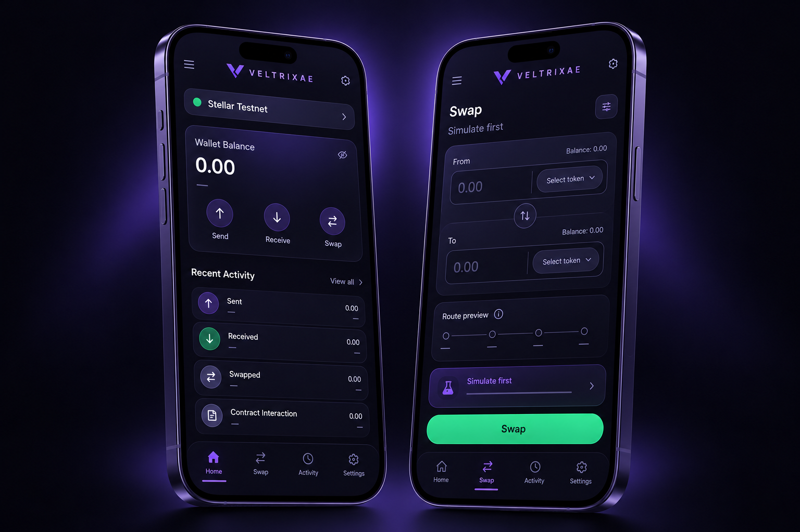

# VELTRIXAE Frontend

**Trade Beyond Boundaries.** VELTRIXAE is a premium, non-custodial decentralized trading interface for Stellar. This repository defaults to **Stellar Testnet**; Mainnet is intentionally not selectable.

## Product mockups

> Concept previews use placeholder values only. Live balances, routes, and transactions are always retrieved from configured Stellar services.


<p align="center">
  
</p>

## Included

- Responsive marketing site and application workspace
- Freighter wallet access, network detection, disconnect, copy, and signing
- Live aggregator quotes with route, rate, slippage, impact, deadline, and minimum received
- Mandatory Stellar RPC simulation before wallet signing
- Direct, validated Stellar Horizon balances, transactions, ledger health, and latency
- Authorized Freighter session restoration and visibility-based account refresh
- Pools, liquidity preview, portfolio, markets, transactions, and analytics interfaces
- Zod-validated API responses with retry and explicit error states
- Keyboard command palette (`Ctrl/⌘ + K`), route recovery, loading skeletons, and installable web manifest
- Component, wallet, Horizon, schema, accessibility, and responsive tests with coverage gates

## Development

Requires Node.js 22+ and pnpm 12.16.1.

```bash
cp .env.example .env.local
pnpm install
pnpm dev
```

Open <http://localhost:3000>. Codespaces forwards port 3000 automatically.

## Environment

| Variable | Required | Purpose |
| --- | --- | --- |
| `NEXT_PUBLIC_APP_URL` | Recommended | Canonical app URL |
| `NEXT_PUBLIC_VELTRIXAE_API_URL` | Live data/actions | Validated API base URL |
| `NEXT_PUBLIC_STELLAR_RPC_URL` | Yes | Soroban Testnet RPC |
| `NEXT_PUBLIC_STELLAR_HORIZON_URL` | Yes | Horizon Testnet API |
| `NEXT_PUBLIC_SWAP_CONTRACT_ID` | Swaps | Verified Testnet swap contract |
| `NEXT_PUBLIC_FACTORY_CONTRACT_ID` | Liquidity | Verified Testnet factory contract |

Never provide private keys or recovery phrases. Wallet authorization stays in Freighter.

## Backend contract

The frontend does not assume unverified endpoints. A configured API must provide `GET /v1/assets`, `/v1/pools`, `/v1/portfolio/:account`, `/v1/analytics`; `POST /v1/swap/quote`, `/v1/swap/build`, and `/v1/transactions/submit`.

Responses are validated in `lib/api/schemas.ts`. Missing pricing and history remain unavailable—never fabricated. A built XDR is independently simulated against Stellar Testnet RPC before signing.

## Verification

```bash
pnpm lint
pnpm typecheck
pnpm test
pnpm build
```

## Automation and dependency bots

- Dependabot checks npm packages every day and GitHub Actions every week, grouping related Next.js, Stellar, testing, and production updates.
- Frontend CI runs lint, strict type checking, coverage-gated tests, and a production build for every pull request and `main` push.
- CodeQL scans JavaScript and TypeScript on changes and every Tuesday.
- Dependency Review blocks pull requests that introduce dependencies with moderate-or-higher known vulnerabilities.

Repository settings should require the CI, CodeQL, and Dependency Review checks before merging to `main`.

## Deployment

The app is prepared for Vercel but is not deployed automatically. Configure the environment, verify all Testnet contract IDs, and use your normal review flow. Keep Mainnet disabled until production contracts and operational controls are reviewed.

Licensed under the [MIT License](LICENSE).
