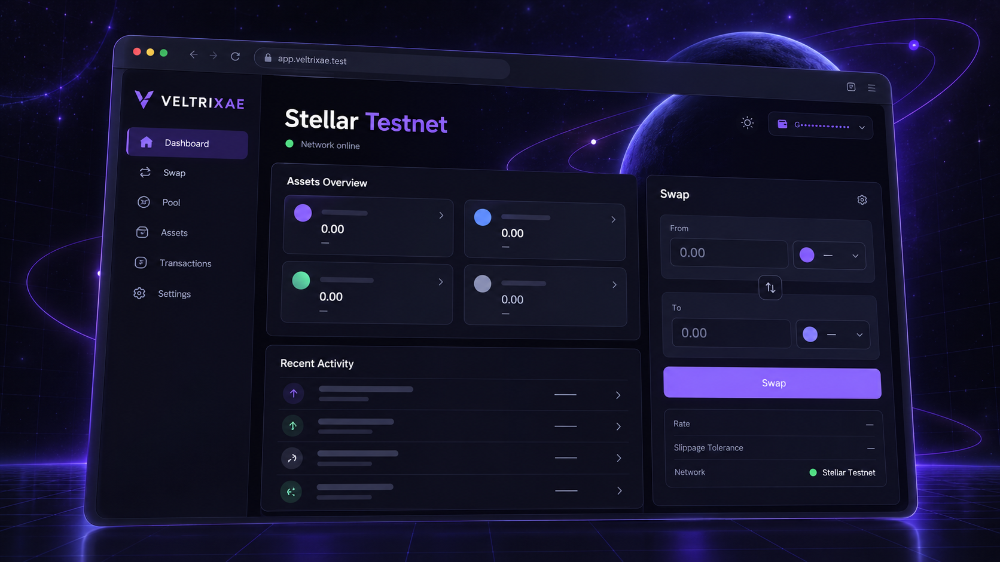

# VELTRIXAE Frontend
VELTRIXAE is a non-custodial Stellar trading interface. This repository targets **Stellar Testnet only**; Mainnet is intentionally unavailable.



## Current status

| Feature | Status |
| --- | --- |
| Freighter connect, network detection, address, and signing | Implemented; mocked tests pass, live wallet not verified in this audit |
| Horizon balances, recent transactions, and network health | Implemented with validated live Testnet reads |
| Backend tokens, pools, markets, quotes, preparation, and status | Integrated against the published `/api/v1` contract |
| Swap execution | Guarded implementation; unavailable while backend quotes are non-executable |
| Pool and market discovery | Read-only, backed by verified factory snapshots |
| Market and asset explorer | Searchable by code, issuer, and contract ID; duplicate codes disambiguated by issuer/contract; verification badges link to provenance |
| Trading pairs, pools, liquidity, and issuer details | Displayed from verified snapshots |
| Historical charts | Shown only when supported data exists; unsupported metrics render an explicit unavailable state |
| Indexed protocol analytics | Volume, liquidity, transaction count, and token performance series with aggregation windows, source ledger, and indexed-at freshness; partial indexing and gaps shown explicitly |
| Add/remove liquidity | Unavailable; no supported preparation API |
| Portfolio quantities | Available from Horizon |
| USD prices, LP positions, history, volume, and TVL | Unavailable without verified providers/indexers |
| End-to-end, responsive, and accessibility tests | Playwright with deterministic wallet/API fixtures; Chromium desktop and mobile projects; critical accessibility violations fail CI |
| Observability | Privacy-conscious error monitoring and web-vitals reporting; frontend errors correlated with backend request identifiers |
| Mainnet readiness gate | Build-time gate; Mainnet stays disabled unless verified contracts and an explicit release flag are present |

The inspected backend documents no completed VELTRIXAE Testnet deployment and currently returns `executable: false` quotes. This frontend does not claim a successful live swap and does not substitute mock financial data. Analytics never render missing data as zero; unsupported metrics show an unavailable state.

## Development

Requires Node.js 22+ and pnpm 12.16.1.

```bash
cp .env.example .env.local
pnpm install --frozen-lockfile
pnpm dev
```

Open <http://localhost:3000>.

## Environment

| Variable | Required | Purpose |
| --- | --- | --- |
| `NEXT_PUBLIC_APP_URL` | Recommended | Canonical frontend URL |
| `NEXT_PUBLIC_VELTRIXAE_API_URL` | For backend data | Backend origin; the client adds `/api/v1` |
| `NEXT_PUBLIC_STELLAR_RPC_URL` | Optional | Defaults to Stellar Testnet RPC |
| `NEXT_PUBLIC_STELLAR_HORIZON_URL` | Optional | Defaults to Testnet Horizon |

Never provide private keys or recovery phrases. All wallet authorization stays in Freighter. Signed envelopes are submitted directly to Stellar RPC, never to the VELTRIXAE backend.

## Verification

```bash
pnpm lint
pnpm typecheck
pnpm test:coverage
pnpm test:e2e
pnpm build
```

Wallet and backend tests are mocked unless explicitly documented as live. Playwright end-to-end, responsive, and accessibility suites run in CI against deterministic wallet and API fixtures without real funds or private keys. See [testing](docs/TESTING.md) and the [frontend audit](docs/FRONTEND_AUDIT.md).

## Documentation

- [Architecture](docs/ARCHITECTURE.md)
- [Frontend setup](docs/FRONTEND_SETUP.md)
- [Wallet integration](docs/WALLET_INTEGRATION.md)
- [Backend integration](docs/BACKEND_INTEGRATION.md)
- [Testing](docs/TESTING.md)
- [Contributing](CONTRIBUTING.md)
- [Security](SECURITY.md)

## Deployment

For Vercel, import the repository, use Node.js 22 and pnpm, set the public environment variables, and deploy.

Mainnet is disabled by default and guarded by a build-time readiness gate. It cannot be enabled without verified contract identifiers and an explicit release flag. Do not enable Mainnet or claim executable trading until backend readiness, contract identifiers, wallet review, RPC submission, and finality have been verified end to end.

Operational readiness requires the release, rollback, incident, and environment-validation checklists. Telemetry must never include wallet secrets, signed XDR, or sensitive account data. Health and configuration failures are observable, and frontend errors are correlated with backend request identifiers.

Licensed under the [MIT License](LICENSE).
